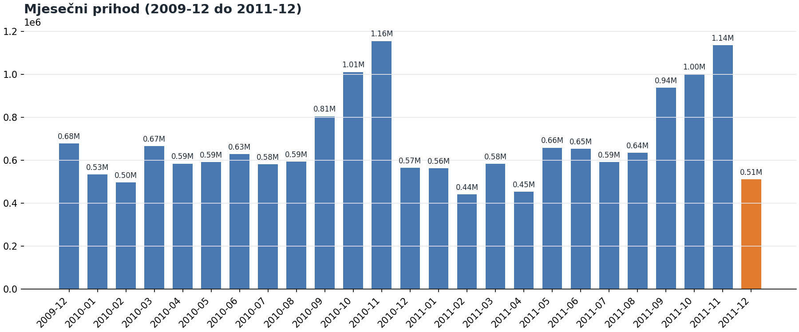
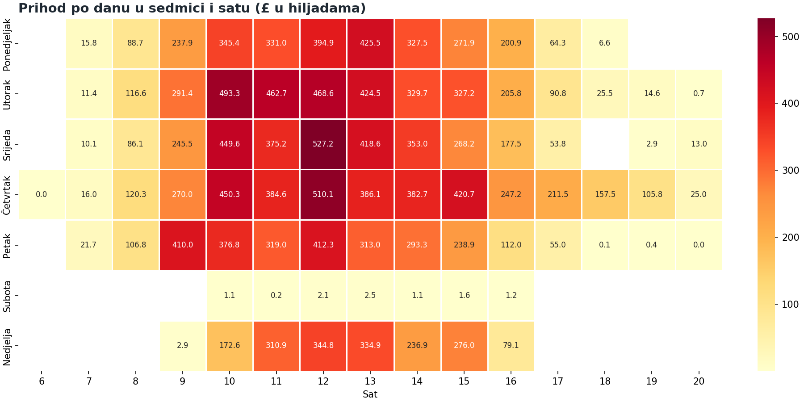
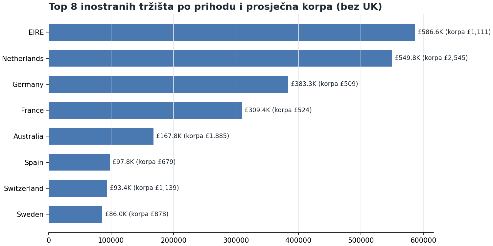
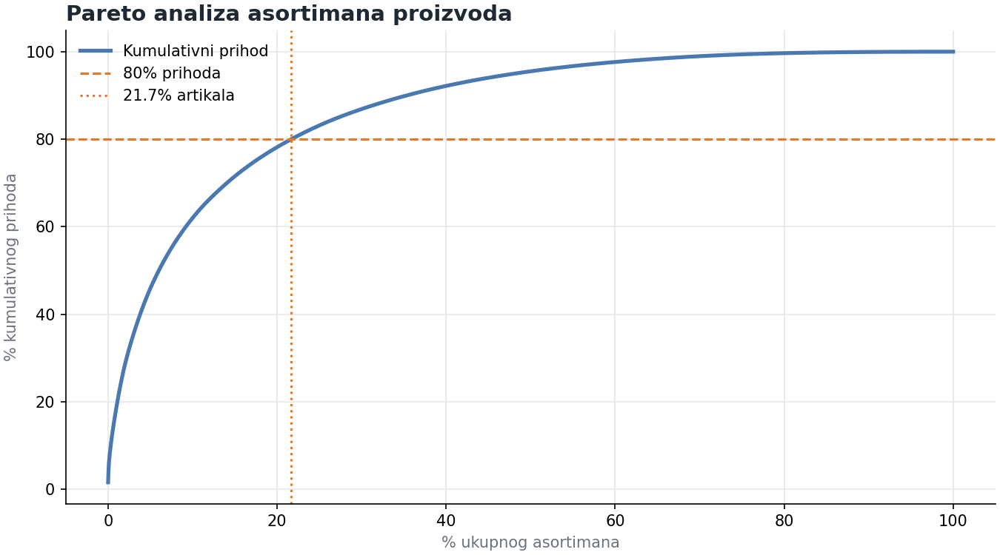
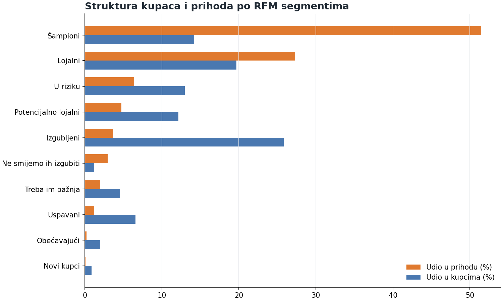
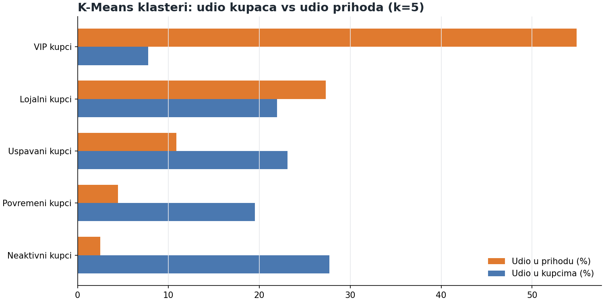
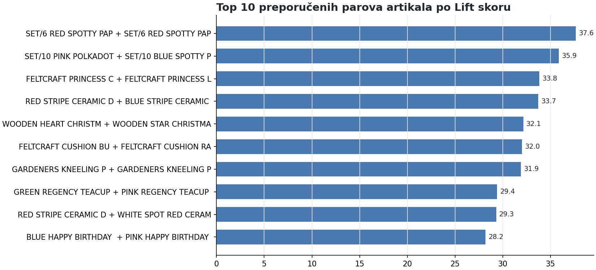
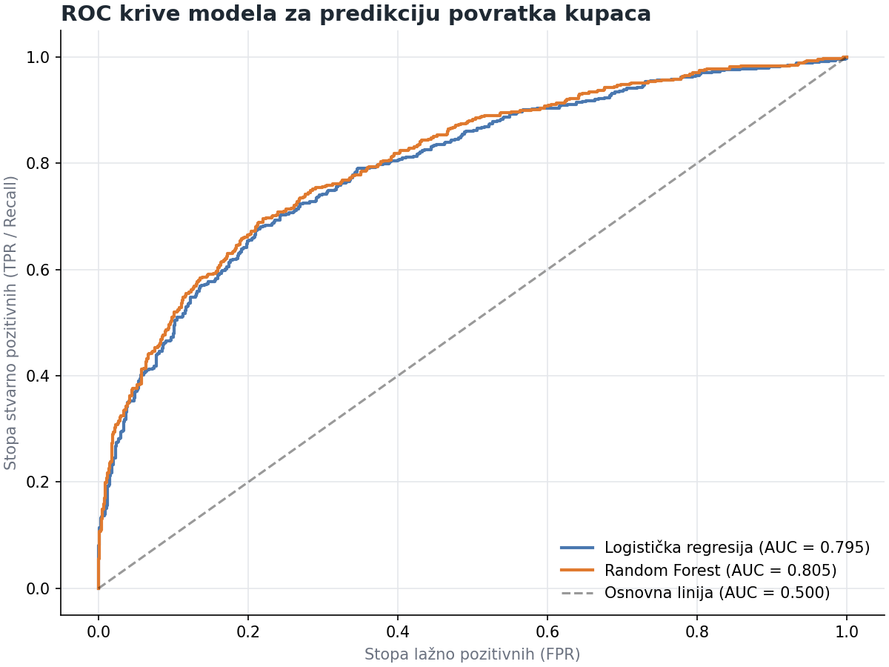
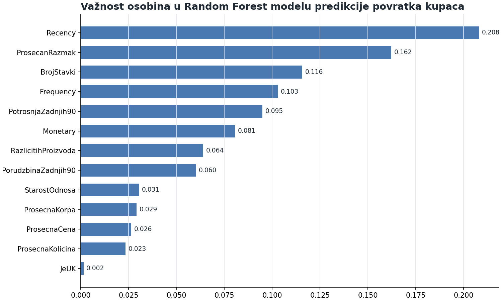

# FINALNI IZVEŠTAJ — Analiza podataka online maloprodaje

**Predmet analize:** Transakcioni podaci britanskog online trgovca poklonima i dekoracijom (01.12.2009 – 09.12.2011)  
**Datum izrade izveštaja:** Novembar 2026.  
**Autor:** Antigravity Data Science Team  

---

## 1. Rezime za menadžment

1. U posmatranom dvogodišnjem periodu kompanija je ostvarila ukupan čist prihod od **17.068.583 £** kroz **36.594 porudžbine** realizovane od strane **5.852 identifikovana kupca**.
2. Prihod je ekstremno koncentrisan: segment kupaca „Šampioni“ čini svega **14,2% kupaca**, ali generiše čak **51,4% ukupnog prihoda** preduzeća, dok po Paretovom pravilu **21,7% artikala** donosi 80% prihoda.
3. Domaće tržište Velike Britanije nosi **83,7% prihoda**, dok ključna izvozna tržišta (Irska i Holandija) imaju znatno manji broj kupaca, ali enormnu prosečnu korpu (preko **1.111 £**, odnosno **2.545 £**), što nedvosmisleno ukazuje na udeo velikih B2B veleprodajnih distributera.
4. Poslovanje odlikuje izrazita i stabilna četvoromesečna sezonalnost sa vrhuncem u novembru (**1,16M £** u 2010. i **1,14M £** u 2011. godini) i minimumom u februaru (**442K £**), uz radno vreme koncentrisano radnim danima između 09:00 i 16:00 časova.
5. Razvijeni model mašinskog učenja (*Random Forest*) sa strogim vremenskim presekom uspešno predviđa povratak kupaca u narednih 90 dana uz tačnost od **74,4%** i **ROC AUC od 0,805** (u poređenju sa 56,5% osnovne linije), pri čemu su svežina kupovine (*Recency*) i istorijski tempo naručivanja ključni indikatori.

---

## 2. Podaci i priprema

Analiza je započeta sa sirovim skupom od **1.067.371 transakcije** smeštenim u dva radna lista Excel datoteke (`Year 2009-2010` i `Year 2010-2011`).

### Otkriveni problemi u sirovim podacima:
1. **Preklapanje radnih listova:** Identifikovano je preklapanje od 01.12. do 09.12.2010. godine sa **1.088 računa** upisanih u oba lista. Da nisu uklonjeni, promet za decembar 2010. bio bi veštački dupliran.
2. **Kupovine bez identifikacije:** 243.007 redova (22,8%) nije imalo `CustomerID` (gostujući/neregistrovani kupci).
3. **Storna i otkazivanja:** Fakture sa prefiksom `C` (storno) obuhvatale su 19.104 stavke u 8.292 računa u vrednosti od 1,46M £ (8,6% prometa).
4. **Službeni unosi i nekorektne vrednosti:** Unosi za poštarinu (`POST`, `DOT`), bankarske troškove (`BANK CHARGES`), ručna prilagođavanja (`M`, `ADJUST`), kao i stavke sa cenom ili količinom manjom ili jednakom nuli.

### Tok i levak čišćenja podataka:

| Korak obrade | Uklonjeno zapisa | Preostalo zapisa | Obrazloženje |
|---|---|---|---|
| **Sirovi podaci (oba lista)** | — | **1.067.371** | Polazna baza (2 godine poslovanja) |
| **Uklanjanje identičnih duplikata** | 34.335 | 1.033.036 | Eliminacija preklapanja listova i tehničkih dupliranja |
| **Izdvajanje storno računa (C)** | 19.104 | 1.013.932 | Snimljeno u `otkazivanja.parquet` radi analize kvaliteta |
| **Uklanjanje zapisa bez `CustomerID`** | 234.437 | 779.495 | Neophodno za modelovanje ponašanja i lojalnosti kupaca |
| **Uklanjanje administrativnih šifara** | 2.916 | 776.579 | Eliminacija ne-artikalskih stavki (poštarine, provizije) |
| **Uklanjanje `Quantity <= 0` i `UnitPrice <= 0`** | 0 | **776.579** | Sve negativne stavke su već bile obuhvaćene stornom |

Nakon sprovedenog procesa, dobijen je čist skup od **776.579 transakcija (72,8% sirovih)** sa **5.852 jedinstvena kupca**, **36.594 fakture** i **4.620 artikala**, sa ukupnim zabeleženim prihodom od **17.068.583 £**.

---

## 3. Ključni nalazi analize

### Nalaz 1: Sezonalnost i radno vreme potvrđuju B2B profil poslovanja
Promet kompanije ima izražen sezonski karakter: prodaja raste od septembra, a vrhunac dostiže u oktobru i novembru (oko 1,15 miliona £ mesečno), dok je januar i februar period zatišja (oko 440–560 hiljada £). Ovaj ciklus se identično ponavlja u obe godine.

Heatmapa transakcija po danu i satu pokazuje da se kupovine realizuju radnim danima između 09:00 i 16:00 časova. Subota je operativno neradni dan (svega 0,06% prometa). Kupci kupuju tokom radnog vremena svojih preduzeća, što ukazuje da su dominantni kupci pravna lica i vlasnici trgovina koji se pripremaju za božićnu maloprodajnu sezonu.

---

### Nalaz 2: Geografska raspodela i uloga inostranih distributera
Iako Velika Britanija generiše **83,7% prihoda** sa preko 5.300 kupaca, struktura inostranih kupaca otkriva značajan veleprodajni potencijal:
- **Holandija:** 22 kupca ostvaruju prihod od 549.773 £ sa prosečnom korpom od **2.545 £** (preko 24.000 £ po kupcu).
- **Irska (EIRE):** Samo 3 kupca donose 586.626 £ sa prosečnom korpom od **1.111 £** (preko 195.000 £ po kupcu).
- **Australija:** 15 kupaca sa prosečnom korpom od **1.885 £**.

Za inostrana tržišta kompanija ne funkcioniše kao klasičan maloprodajni sajt, već kao primarni dobavljač velikim regionalnim distributerima.

---

### Nalaz 3: Paretov zakon asortimana proizvoda
Analiza kumulativnog prihoda po artiklima pokazuje da tačno **21,7% asortimana (1.001 artikal)** generiše **80% celokupnog prihoda**, što predstavlja savršenu ilustraciju Paretovog principa 80/20.

Najprodavaniji proizvod po prihodu je *REGENCY CAKESTAND 3 TIER* (preko 277.000 £), dok je po količini vodeći *WORLD WAR 2 GLIDERS* (preko 105.000 komada). Detektovana je i anomalija: proizvod *PAPER CRAFT , LITTLE BIRDIE* kupljen je u jednoj jedinoj fakturi u iznosu od 168.469 £, što predstavlja izolovan komercijalni ugovor.

---

### Nalaz 4: Segmentacija kupaca (RFM i K-Means)
Primenom RFM metodologije (Recency, Frequency, Monetary) baza od 5.852 kupca podeljena je u poslovne segmente. Rezultati pokazuju ekstremnu asimetriju vrednosti:

- **Šampioni (14,2% kupaca):** Donose **51,4% prihoda**. Kupuju često i u velikim iznosima.
- **Lojalni kupci (19,7% kupaca):** Donose **27,3% prihoda**.
- **Ne smemo ih izgubiti (1,2% kupaca / 72 klijenta):** Donose **2,9% prihoda (503.405 £)**. Nekadašnji veliki naručioci koji nisu kupovali duže vreme.
- **Izgubljeni kupci (25,8% kupaca):** Donose svega **3,6% prihoda**.

Klasterovanje algoritmom K-Means ($k=5$) potvrdilo je postojanje prirodnog klastera VIP klijenata (7,8% baze sa 54,9% prihoda).

---

### Nalaz 5: Povezana kupovina artikala (Market Basket & Association Rules)
Analiza asocijativnih pravila na 300 najfrekventnijih artikala identifikovala je parove sa Liftom većim od 30.

Kupci kupuju u tematskim i dizajnerskim garniturama:
- *RED SPOTTY PAPER CUPS* + *RED SPOTTY PAPER PLATES* (Lift: **37,64**, 489 zajedničkih korpi),
- *PINK POLKADOT CANDLES* + *BLUE SPOTTY CANDLES* (Lift: **35,87**),
- *GREEN REGENCY TEACUP* + *PINK REGENCY TEACUP* (Lift: **29,41**).

---

## 4. Prediktivni model — Da li će se kupac vratiti?

### Postavka problema i metodološka ispravnost
U prvoj fazi demonstriran je naivan model sa namernim curenjem podataka (*data leakage*), gde je cilj bio definisan kao kupovina u poslednjih 30 dana na celom skupu. Taj model je ostvario nerealnu tačnost od 98% i AUC od 0,9998, ali je potpuno neupotrebljiv.

Ispravan prediktivni zadatak postavljen je uvođenjem **strogog vremenskog preseka na dan 10.09.2011. (kraj podataka minus 90 dana)**:
- **Prošlost (trening osobine):** 13 inženjerski izvedenih osobina o kupcu (RFM, prosek korpe, razmak narudžbina, broj artikala, UK poreklo, aktivnost u zadnjih 90 dana) kreirane isključivo pre preseka.
- **Budućnost (cilj):** Da li je kupac ostvario ijednu kupovinu u narednih 90 dana (1/0).
- U uzorak ulaze 5.256 kupaca aktivnih pre preseka, od kojih se **43,6% vratilo** u posmatranom periodu.

### Poređenje modela na test skupu (1.314 kupaca):

| Model | Tačnost | Preciznost | Odziv (Recall) | F1-skor | ROC AUC |
|---|---|---|---|---|---|
| **Osnovna linija (Dummy - najčešća klasa)** | 56,5% | 0,000 | 0,000 | 0,000 | 0,500 |
| **Logistička regresija (sa StandardScaler)** | 73,1% | 0,692 | 0,691 | 0,691 | 0,795 |
| **Random Forest Classifier** | **74,4%** | **0,720** | **0,671** | **0,695** | **0,805** |

### Značaj osobina i tumačenje modela
Analiza važnosti osobina (*feature importance*) u Random Forest modelu pokazuje da su najuticajniji faktori za povratak kupca:
1. **Recency (20,5%):** Broj dana od poslednje kupovine do datuma preseka.
2. **ProsecanRazmak (15,5%):** Prosečan ciklus naručivanja klijenta.
3. **BrojStavki (10,3%) i Frequency (9,0%):** Ukupna dubina saradnje.

Model pouzdano signalizira kada kupac premaši svoj uobičajeni vremenski razmak između narudžbina, omogućavajući pravovremenu intervenciju pre trajnog gubitka klijenta.

---

## 5. Preporuke za menadžment

1. **Uvođenje VIP programa i namenskih account menadžera za „Šampione“:**  
   Segment od 830 kupaca nosi preko 8,7 miliona £ (51,4% prihoda). Preporučuje se dodela ličnih agenata prodaje, uvođenje ugovorenih rabata na količinu i prioritetna isporuka kako bi se ovi ključni klijenti trajno osigurali.
2. **Hitna proaktivna reaktivacija segmenta „Ne smemo ih izgubiti“:**  
   Baza od 72 nekadašnja krupna kupca generisala je preko 500.000 £ pre nego što je prekinula narudžbine. Preporučuje se lični telefonski poziv komercijalnog direktora, ispitivanje razloga nezadovoljstva i ponuda 15% popusta dobrodošlice na artikle koje su ranije redovno uzimali.
3. **Pravovremena nabavka i priprema zaliha za Q4 (sezonski plan):**  
   Zbog dokazanog skoka potražnje u oktobru i novembru (dupliranje mesečnog prometa na preko 1,1M £), nabavku za 1.000 ključnih Pareto artikala (21,7% asortimana) treba ugovoriti najkasnije do kraja jula kako bi se izbegao nedostatak zaliha.
4. **Implementacija automatskih „Bundle“ ponuda i cross-selling preporuka:**  
   Na sajtu i u B2B elektronskom katalogu povezati komplementarne artikle identifikovane pravilima asocijacije (Lift > 30). Nuditi popust od 5% za kupovinu kompletnog seta (npr. tanjiri + čaše istog dezena), čime se direktno uvećava vrednost prosečne korpe.
5. **Diferencirani B2B komercijalni uslovi za inostrana tržišta (Irska, Holandija):**  
   Prilagoditi web portal za veleprodaju — omogućiti naručivanje na palete, automatski obračun carinskih i transportnih olakšica za narudžbine preko 2.000 £ i uvesti plaćanje na fakturu sa odloženim rokom.
6. **Integracija prediktivnog ML modela u CRM marketing automatizaciju:**  
   Povezati Random Forest model sa CRM sistemom tako da se automatizovani reaktivacioni podsticaj (katalog novih proizvoda ili kupon) šalje kupcu u trenutku kada njegov `Recency` dostigne 120% njegovog uobičajenog prosečnog razmaka kupovina.

---

## 6. Ograničenja analize

Kako bi donosioci odluka imali realnu sliku o dometu izvedenih zaključaka, neophodno je istaći ključna metodološka i operativna ograničenja:

1. **Izostanak identifikacije kod dela kupaca (22,8% transakcija):**  
   Transakcije bez `CustomerID` (preko 234.000 redova) morale su biti isključene iz RFM analize i prediktivnog modelovanja. Zaključci o lojalnosti odnose se isključivo na registrovane kupce (pretežno poslovne subjekte), dok je ponašanje anonimnih gost-kupaca ostalo neobuhvaćeno segmentacijom.
2. **Prihod umesto profita (nepostojanje podataka o troškovima):**  
   Podaci sadrže samo prodajnu cenu (`UnitPrice`) i količinu, dok nabavne cene (*COGS*), troškovi skladištenja, dostave i povrata robe nisu dostupni. Shodno tome, svi zaključci mere bruto promet, a ne neto profitabilnost segmenata.
3. **Vremenski i industrijski kontekst (2009–2011):**  
   Podaci opisuju specifičan period od pre više od decenije i poslovanje jedne britanske trgovačke firme u segmentu ukrasa i poklona. Obrasci ponašanja možda nisu direktno preslikivi na druge industrije bez prilagođavanja.
4. **Predikcija verovatnoće nasuprot inkrementalnom efektu (*Uplift*):**  
   Razvijeni model uspešno odgovara na pitanje *„Ko će se verovatno vratiti?“*, ali ne meri *„Da li će se kupac vratiti isključivo zahvaljujući marketinškom kuponu?“*. Za optimizaciju troškova popusta preporučuje se sprovođenje kontrolisanih A/B testova radi merenja čistog inkrementalnog efekta.

---
*Izveštaj je pripremljen u skladu sa specifikacijom i metodologijom zadatka za studentsku praksu.*
